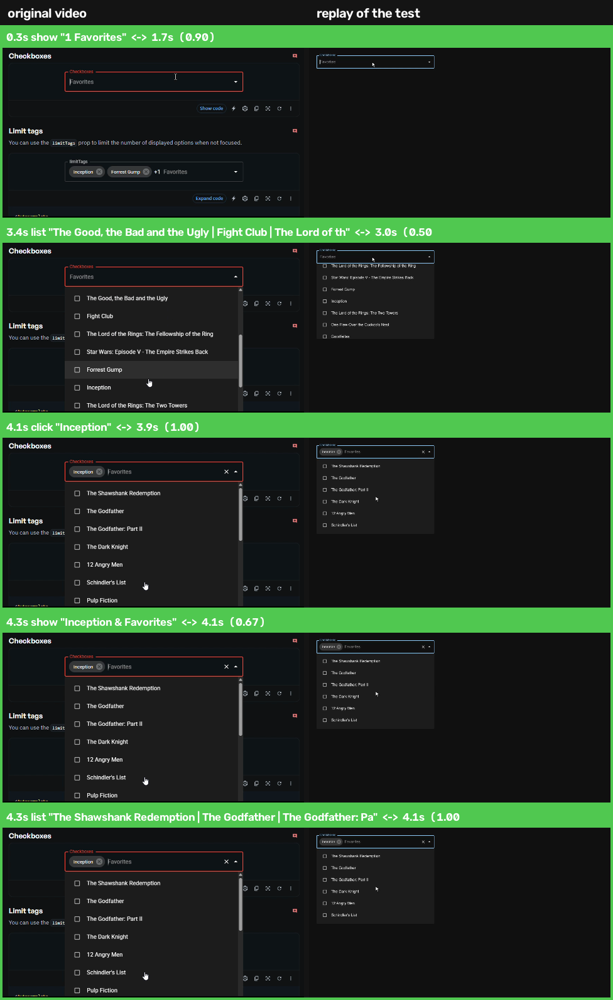

<h1 align="center">dejabug</h1>

<p align="center"><b>Seen it once. Now it fails every time.</b></p>

<p align="center">
Drop in a screen recording of a bug. Get back a Playwright test that fails the same way,
<br>checked against the video, step by step.
</p>

<p align="center">
  <a href="https://github.com/ferreyadinarta/dejabug/actions/workflows/ci.yml"></a>
  <a href="LICENSE"></a>
</p>

> **Status: experiment.** The full loop works end to end on a real MUI bug (below). On a wider benchmark it is not reliable yet; see [Results so far](#results-so-far). I've stopped active work on it, and the code stays here for anyone who wants to pick it up.

<p align="center">
  
  <br><sub>Left: the user's recording of <a href="https://github.com/mui/material-ui/issues/47203">mui/material-ui#47203</a>. Right: the replay of the test dejabug wrote for it, matched moment by moment.</sub>
</p>

```
$ dejabug run bug.mp4 --url http://localhost:5173

1. watch    31 moments, 2 clicks
2. write    agent is writing the repro test
3. verify   replaying the test and comparing it with the video
            ✓ list opens   ✓ scrolls to "Inception"   ✓ click "Inception"
            ✓ chip appears ✓ list jumps back to the top

REPRODUCED  in 173s
  test:   dejabug-out/bug/repro_test.py
  proof:  dejabug-out/bug/verify/strip.png
```

## Why

Bug reports arrive as videos. A customer records their screen, QA attaches a Loom, someone drops an mp4 into a GitHub issue. Then a developer watches it over and over, trying to work out what was clicked so they can make it happen again.

Coding agents can't help much here, because they can't watch video, and a folder of frames doesn't show what was clicked or in what order. When an agent does write a "repro", nothing checks that it fails because of *this* bug and not for some other reason.

dejabug turns the video into something an agent can read, and then checks the agent's test against the video.

## How it works

```
bug.mp4 ──► watch ──► events.jsonl + contact sheet ──► agent writes repro_test.py
                                                                │
          REPRODUCED ◄── same moments, same order? ◄── verify: replay the test,
                                                       watch the replay too
```

`watch` reduces a recording to the moments where the screen settles after a change, reads them with OCR, and tracks the mouse pointer (the small patch that disappears in one spot and reappears unchanged in another), so a 60-second video becomes about 30 lines like:

```json
{"t": 3.4, "type": "content_replaced", "after": ["The Good, the Bad and the Ugly", "Fight Club", "..."]}
{"t": 4.1, "type": "click", "label": "Inception"}
{"t": 4.3, "type": "content_replaced", "after": ["The Shawshank Redemption", "The Godfather", "..."]}
```

`write` hands that log and a contact sheet to a coding agent (Claude Code by default), which writes a Playwright test asserting the *correct* behaviour, so it fails while the bug exists.

`verify` runs the test, records the replay, watches it with the same extractor, and lines the two up. A test that fails for an unrelated reason (wrong button, timeout, a different bug) gets `FAILS_DIFFERENTLY`. When a test doesn't reproduce the video, the report goes back to the agent for another try.

You also get `strip.png`: frames from the user's video next to frames from the replay, one row per matched moment.

## Install

```bash
uv tool install git+https://github.com/ferreyadinarta/dejabug
```

Needs Python 3.12+ and Google Chrome (or set `DEJABUG_BROWSER=chromium` and run `uvx playwright install chromium`). Runs on macOS, Linux and Windows. On macOS, OCR uses Apple Vision; elsewhere it uses RapidOCR.

### In Claude Code

```
/plugin marketplace add ferreyadinarta/dejabug
/plugin install dejabug@dejabug
```

Then share a bug video and ask for a repro, or run `/dejabug bug.mov http://localhost:3000`. The session you're already in writes the test.

## Usage

```bash
dejabug run bug.mov --url http://localhost:3000            # the whole loop
dejabug run bug.mov --url http://localhost:3000 --note "coupon SAVE10 fails at checkout"

dejabug watch bug.mov                                      # just the event log + contact sheet
dejabug verify dejabug-out/bug dejabug-out/bug/repro_test.py
dejabug test dejabug-out/bug/repro_test.py --url http://localhost:3001   # exit 1 = bug still there
```

Repro tests exit `1` when the bug happens, `0` when the correct behaviour happens and `2` when they couldn't reach the state in the video, so they double as regression tests once the bug is fixed.

### Other agents

Any agent CLI that can read files, write a file and run a command works. `{prompt}` is replaced with the instructions, `{prompt_file}` with the path of a file holding them. For example:

```bash
DEJABUG_AGENT='codex exec --full-auto {prompt}' dejabug run bug.mov --url http://localhost:3000
```

## Results so far

Each case is a closed GitHub issue with a screen recording attached. The app is set up at the last version with the bug and the first version with the fix, and dejabug runs blind: the agent sees only the extracted video evidence, never the issue. A case counts as reproduced when verify says `REPRODUCED` on the buggy build and the same test passes on the fixed build.

| Issue | Bug | Result |
|---|---|---|
| [mui/material-ui#47203](https://github.com/mui/material-ui/issues/47203) | Autocomplete list scrolls back to the top after selecting an option | Reproduced on the first attempt in 173 s; the test fails on 7.3.7 and passes on 7.3.8 |
| [mui/material-ui#46665](https://github.com/mui/material-ui/issues/46665) | Select menu inside a Dialog opens and closes immediately | Not reproduced. The menu's brief flash was dropped by the extractor, so the agent saw no bug. The extractor now keeps such frames, but this case hasn't been rerun |
| [tldraw/tldraw#8828](https://github.com/tldraw/tldraw/issues/8828) | Right-click outside the selection shows no context menu | Not reproduced. Clicks on a canvas and on icon buttons have no text to label them, and a right-click looks like a left-click on video. The agent guessed a different bug |
| [excalidraw/excalidraw#10840](https://github.com/excalidraw/excalidraw/issues/10840) | After using the laser pointer in view mode, leaving view mode switches the tool to the hand tool | Timed out (the run happened on a laptop that ran out of memory and went to sleep) |

The full set of 20 issues, including ones that need a backend, a login or seeded data, is in [`bench/issues.json`](bench/issues.json).

What I learned from these runs:

- Bugs that are visible in a settled screen (a list in the wrong place, the wrong text) work well.
- Bugs that are a brief flash, an absence (a menu that should appear and doesn't), or happen on a canvas are much harder to get from video.
- Verifying the replay against the video matters. In the tldraw case, verify found none of the video's 7 clicks in the replay, which made it obvious the agent had tested something other than what the user recorded.

## Limits

- Web apps only. The replay runs in a browser through Playwright.
- Right-clicks, drags and clicks on canvases or icon-only buttons are hard to read from video.
- The app has to run somewhere dejabug can reach, in the state the video starts from. Bugs that depend on a specific account or production data need that data seeded first.
- Tiny, blurry or heavily cropped recordings give the agent less to go on.

## License

MIT. Built by [Ferrey Adinarta](https://github.com/ferreyadinarta).
