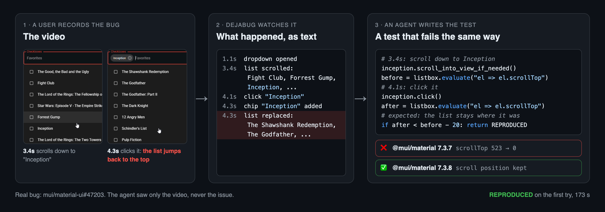
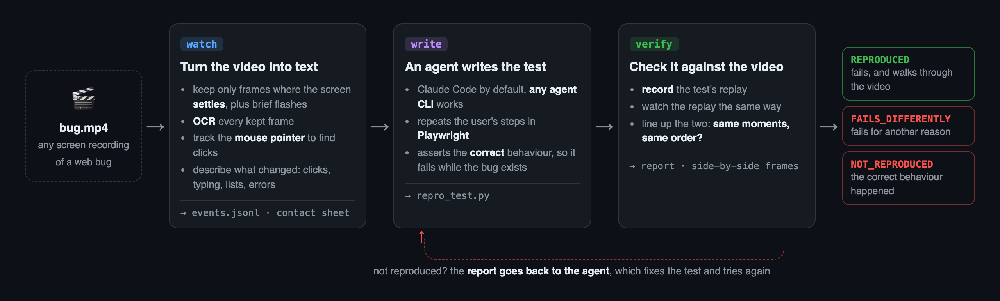

<h1 align="center">dejabug</h1>

<p align="center"><b>Seen it once. Now it fails every time.</b></p>

<p align="center">
For bug videos you didn't record yourself: a customer's mp4, a QA Loom, a clip on a GitHub issue.
<br>dejabug turns the video into steps to reproduce in seconds, and into a Playwright test
<br>that fails the same way, checked against the video.
</p>

<p align="center">
  <a href="https://github.com/ferreyadinarta/dejabug/actions/workflows/ci.yml"></a>
  <a href="LICENSE"></a>
</p>

> **Status: early.** `dejabug steps` is ready to use. `dejabug run` (video to verified test) is in beta and runs with Claude Code only: see [Results so far](#results-so-far) for how often it works.

## Steps to reproduce, from a bug video

```bash
dejabug steps https://github.com/<owner>/<repo>/issues/<number>    # or a local .mp4 / .mov / .webm
```

dejabug downloads the video attached to the issue, reads it on your machine and writes numbered steps, with a close-up image of every click. It needs no app, model or account, and takes about ten seconds. Real output for a recording of an MUI Autocomplete bug:

```
1. Click "Checkboxes" (2.2s)
   - 2.7s: a list opened: Checkboxes, The Shawshank Redemption, The Godfather, ...
2. Click "Favorites" (2.9s)
   - 3.1s: a list closed: The Shawshank Redemption, The Godfather, The Godfather: Part lI, ...
3. Click "Favorites" (3.6s)
   - 3.8s: a list opened: The Shawshank Redemption, The Godfather, The Godfather: Part lI, ...
   - 6.3s: the list changed to: The Lord of the Rings: The Fellowship of the Ring, Star Wars: ..., Forrest Gump, ...
4. Click "Inception" (7.9s)
   - 8.1s: "Favorites" changed to "Inception (X)"
   - 8.1s: the list changed to: The Shawshank Redemption, The Godfather, The Godfather: Part lI, ...
5. Hover over "12 Angry Men" (10.2s)
```

The indented lines are what changed on screen. Here they show the bug: after clicking "Inception", the list jumps back to the top.

## A failing test, checked against the video

```bash
dejabug run bug.mp4 --url http://localhost:5173
```

<p align="center">
  
</p>

With your app running, dejabug drafts a Playwright test from the actions in the video, has a coding agent fill in what the draft can't know (the check for the bug, steps the video implies), and then verifies the result: it records the test's replay, reads it the same way it read the original video, and confirms the two go through the same moments in the same order. A test that fails for an unrelated reason (a wrong button, a timeout, a different bug) is reported as `FAILS_DIFFERENTLY` instead of passing as a repro.

## Why this exists

Bug reports arrive as videos recorded by someone else, with whatever tool they had. Turning one into a test is the slow part, and a generated test that fails proves little on its own: it might fail for a different reason than the one in the video.

So dejabug checks its test against the video itself, and steps mode works from the recording alone, without the app.

## How it works

<p align="center">
  
</p>

`watch` keeps the frames where the screen settles after a change (plus brief flashes, like a menu that opens and closes at once), reads them with OCR, and finds clicks by learning the shape of the mouse pointer and following it. A pointer that only rests on a row is reported as a hover, not a click. A 60-second video becomes a few dozen lines of events and one contact sheet. Steps mode stops here.

`write` turns the clicks and typing into a draft test, one line per action in video order. A coding agent (Claude Code by default, any agent CLI works) may add steps the video implies but can't drop or reorder the drafted ones, and writes the check for the bug.

`verify` replays the test, compares it with the video and, if it doesn't reproduce, sends the report back to the agent for another try. You also get [side-by-side frames](docs/mui-47203-strip.png) of the user's video and the replay.

## Install

```bash
uv tool install git+https://github.com/ferreyadinarta/dejabug
```

Needs Python 3.12+ and Google Chrome (or set `DEJABUG_BROWSER=chromium` and run `uvx playwright install chromium`). Runs on macOS, Linux and Windows. On macOS, OCR uses Apple Vision; elsewhere it uses RapidOCR.

### In Claude Code

```
/plugin marketplace add ferreyadinarta/dejabug
/plugin install dejabug@dejabug
```

Then share a bug video and ask for a repro, or run `/dejabug bug.mov http://localhost:3000`. The session you're already in writes the test.

## Usage

```bash
dejabug steps bug.mov                                      # steps to reproduce, no app needed
dejabug run bug.mov --url http://localhost:3000            # video to verified failing test
dejabug run bug.mov --url http://localhost:3000 --format ts   # also write a @playwright/test spec
dejabug run bug.mov --url http://localhost:3000 --note "coupon SAVE10 fails at checkout"

dejabug watch bug.mov                                      # just the event log + contact sheet
dejabug verify dejabug-out/bug dejabug-out/bug/repro_test.py
dejabug test dejabug-out/bug/repro_test.py --url http://localhost:3001   # exit 1 = bug still there
```

Every command also takes a link to an issue in a public GitHub repo instead of a file (private repos aren't supported yet). Repro tests exit `1` when the bug happens, `0` when the correct behaviour happens and `2` when they couldn't reach the state in the video, so they double as regression tests once the bug is fixed.

### Other agents

Steps mode is a plain command and works anywhere. Test mode runs its agent step with Claude Code; other agent CLIs can be plugged in, but haven't been tested yet. Any agent CLI that can read files, write a file and run a command should work. `{prompt}` is replaced with the instructions, `{prompt_file}` with the path of a file holding them. For example:

```bash
DEJABUG_AGENT='codex exec --full-auto {prompt}' dejabug run bug.mov --url http://localhost:3000
```

### Apps that need a login

Save a logged-in session once, then pass it to every run:

```bash
npx playwright codegen --save-storage=auth.json http://localhost:3000   # log in, then close the window
dejabug run bug.mov --url http://localhost:3000 --storage-state auth.json
```

### Model and budget

The agent uses `sonnet` by default and stops once a run has spent $1.50. Change either with `--model` and `--max-cost`, or with `DEJABUG_MODEL` and `DEJABUG_MAX_COST`.

## Cost and speed

| | Steps mode | Test mode (measured so far) |
|---|---|---|
| Time | about 10 s | about 4 min per bug |
| Cost | free, runs locally | about $0.45 per bug with `sonnet` |

These test-mode numbers come from two runs on the development set below, not from the benchmark.

Only the "write" step uses a model. `watch` and `verify` run on your machine and cost nothing, and they take seconds to a minute for a typical recording. Every run prints what the agent spent and saves it to `result.json`.

## What leaves your machine

`watch` and `verify` are local: the video, the frames and the replay never leave your computer.

The agent step sends the event log, the contact sheet, the keyframes it opens and the test output to the model provider (Anthropic, with the default Claude Code setup). If a recording shows customer data or secrets, crop or blur it before running dejabug, or point `DEJABUG_AGENT` at an agent that runs on a local model.

## Safety

The agent's tools are limited to reading and editing files and running Python; it works inside the output folder. The tests it writes drive a real browser against the URL you give, and they click whatever the user clicked in the video. Run dejabug against a local or staging copy of your app, never production.

## What videos work

Screen recordings of a web app in a desktop browser: mp4, mov or webm from QuickTime, OBS, Loom (downloaded) or a GitHub issue attachment. Videos wider than 1280 px are scaled down; smaller ones are used as they are. Phone recordings, GIFs and Loom links aren't supported yet. OCR has only been tested on English interfaces so far.

## dejabug, session replay or a capture tool?

If your app already records sessions (Sentry Replay, LogRocket, PostHog), or your reporters use a bug capture tool such as Jam, use that data: it comes with console logs, network requests or the DOM, and is more precise than video. dejabug is for the reports where a plain video is all you have, from a customer, a client, QA, or a GitHub issue.

## Results so far

A case counts as reproduced only when verify says `REPRODUCED` on the buggy version and the same test passes on the fixed version. The agent runs blind: it sees the extracted video evidence, never the issue text.

**Development set** (bugs I picked while building dejabug, so these show progress, not a success rate):

| Recording | Result | Cost | Time |
|---|---|---|---|
| [mui/material-ui#47203](https://github.com/mui/material-ui/issues/47203), the reporter's own video | Reproduced on the first attempt; the test fails on 7.3.7 and passes on 7.3.8 | $0.48 | 4.6 min |
| The same MUI bug, recorded by me | Reproduced on the first attempt; passes on 7.3.8 | $0.41 | 3.6 min |

**Benchmark (in progress):** 20 closed GitHub issues with an attached video, picked by a rule written down before any run ([protocol](bench/PROTOCOL.md)). A case succeeds only if the test fails on the version before the fix and passes on the version after it. The sample only includes apps that run with `npm install`, which makes it easier than real-world videos. The success rate will be published here, whatever it is.

What I learned so far:

- Bugs that show up on a settled screen (a list in the wrong place, the wrong text) work well.
- A brief flash, an absence (a menu that should appear and doesn't), clicks on a canvas, and right-clicks are much harder to get from video.
- Verifying against the video catches tests that fail for the wrong reason. It can't catch a check that tests the wrong thing, so the agent is told to assert only on something the video shows going wrong; the fixed-version check above is the final word.

## Limits

- Web apps only. The replay runs in a browser through Playwright.
- Right-clicks, drags and clicks on canvases or icon-only buttons are hard to read from video.
- The app has to run somewhere dejabug can reach, in the state the video starts from. Bugs that depend on a specific account or production data need that data seeded first.
- Tiny, blurry or heavily cropped recordings give the agent less to go on.

## License

MIT. Built by [Ferrey Adinarta](https://github.com/ferreyadinarta).
